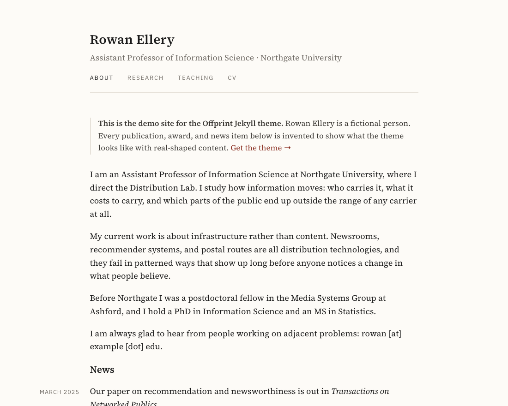
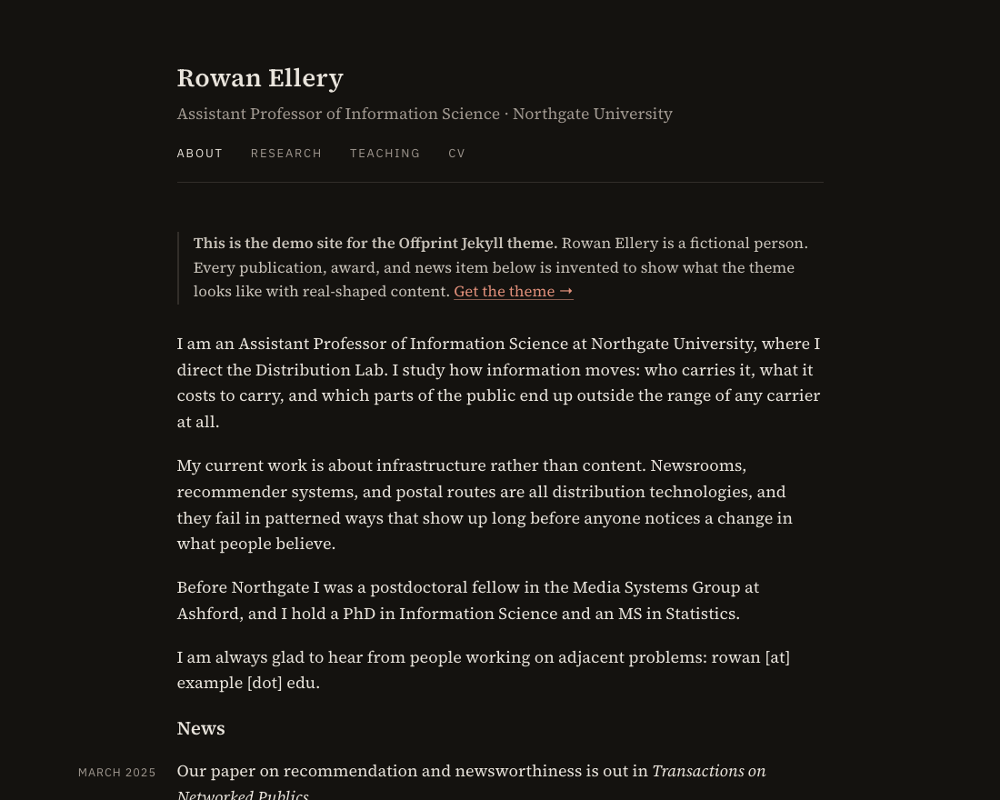
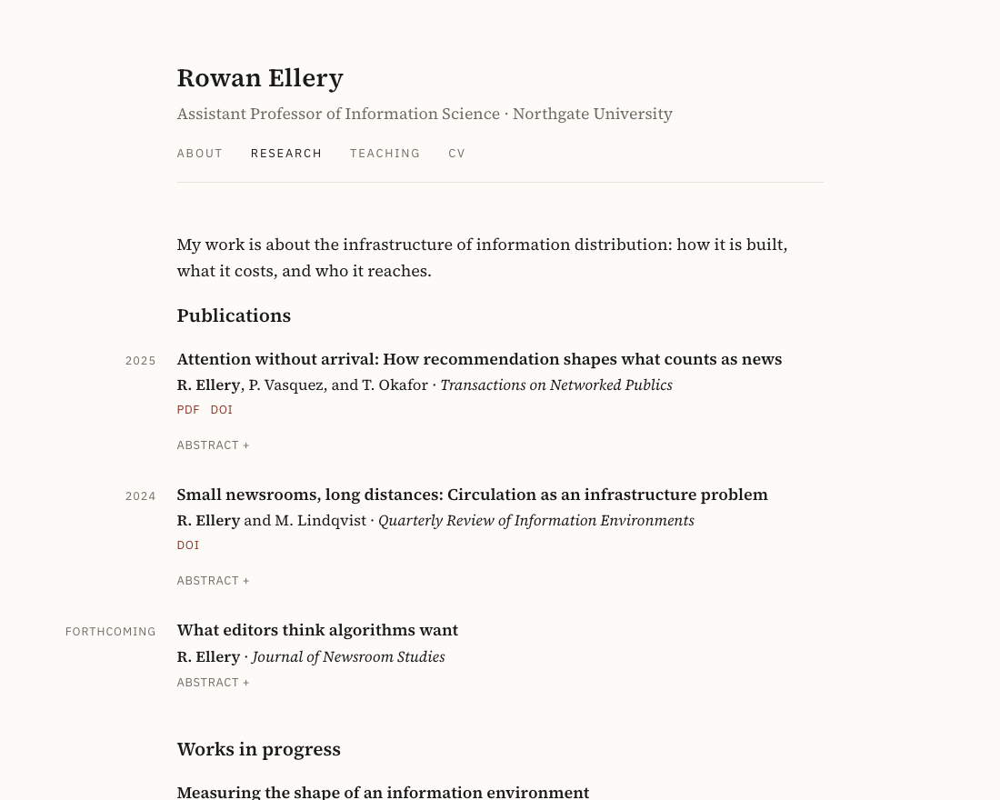
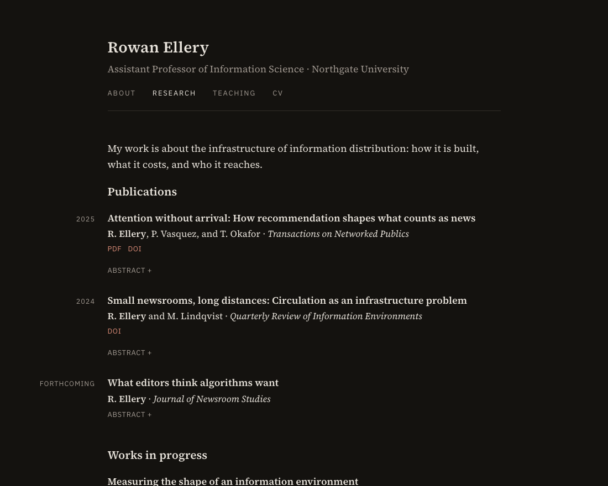

# Offprint

A Jekyll theme for academic personal sites. One column of well-set text, no
sidebar, no avatar, no icon fonts, no JavaScript.

**[See the live demo →](https://gojiplus.github.io/jekyll-theme-offprint/)**

| Light | Dark |
|---|---|
|  |  |
|  |  |

Dark mode follows the reader's system setting — there is no toggle and no
JavaScript.

An *offprint* is a separately printed copy of a single journal article — what
academics used to mail to colleagues who asked for their work. The theme is
built for the same job: put the work in front of someone with as little between
them and it as possible.

- Source Serif 4 for text, IBM Plex Sans for metadata, both self-hosted
  (~108 KB) — no Google Fonts request, no third-party connection
- Dark mode via `prefers-color-scheme`, contrast-checked to WCAG AA
- Publications as structured data, rendered by a template
- Dates and years hang in the left margin on wide screens
- One layout, four includes, one stylesheet — small enough to read in full

## Install

Add to your site's `_config.yml`:

```yaml
remote_theme: gojiplus/jekyll-theme-offprint
plugins:
  - jekyll-remote-theme
```

And to your `Gemfile`:

```ruby
group :jekyll_plugins do
  gem "jekyll-remote-theme"
end
```

`jekyll-remote-theme` is **not** supported by GitHub's classic Pages builder in
all cases; deploying via GitHub Actions is the reliable path. The demo site's
[`.github/workflows/pages.yml`](.github/workflows/pages.yml) is a working
example you can copy verbatim.

## Configure

Jekyll themes distribute only `_layouts`, `_includes`, `_sass`, and `assets` —
so `_data/` stays with your site. Nothing breaks without it (a missing data file
renders as an empty nav rather than an error), but you will want all three.

### `_config.yml`

```yaml
title: "Your Name"
description: "One sentence used as the default meta description."
url: "https://yourname.github.io"
baseurl: ""

author:
  short_name: "Y. Name"      # bolded automatically in publication bylines
  role: "Your Title · Your Institution"
  email: "you@example.edu"
  googlescholar: "https://scholar.google.com/citations?user=..."
  github: "https://github.com/you"
  bluesky: "https://bsky.app/profile/you"
  orcid: "https://orcid.org/0000-..."
  linkedin: "https://www.linkedin.com/in/you"

google_analytics: "G-XXXXXXXXXX"   # omit entirely to emit no analytics
noindex: false                     # true on a staging site to block indexing

# Favicons. The theme ships none -- these point at files in your own repo.
# Any you omit emit no <link> at all.
favicon: /images/favicon.ico
favicon_svg: /images/favicon.svg
apple_touch_icon: /images/apple-touch-icon-180x180.png
webmanifest: /images/manifest.json
```

Every one of these is optional. An absent key emits **no markup at all** — no
empty tags, no bare `mailto:`, no analytics snippet with a blank id.

### `_data/navigation.yml`

```yaml
- title: About
  url: /
- title: Research
  url: /research/
- title: CV
  url: /files/cv.pdf
```

The active-page highlight maintains itself by comparing `page.url` to each
item's `url`.

### `_data/social.yml`

Controls footer link order and labels; the URLs come from `author:` above. A row
whose `author` key is unset renders nothing — deleting the key in `_config.yml`
is how you remove a link.

```yaml
- key: email
  label: Email
  prefix: "mailto:"
- key: googlescholar
  label: Scholar
- key: github
  label: GitHub
```

### `_data/publications.yml`

```yaml
- title: "Paper title in sentence case"
  authors: ["A. Coauthor", "Y. Name", "B. Coauthor"]
  year: 2025
  venue: "Journal Name"
  status: published          # published | forthcoming | wip
  pdf: /files/paper.pdf
  doi: "https://doi.org/..."
  abstract: >
    Shown in a collapsible <details> block.
```

`title` and `status` are required; `authors` is required except for `wip`;
`year` is required for `published`. Everything else is optional and omitted
cleanly when absent. `note` replaces the byline for entries without authors.

The hanging label is the `year` for published work, the word `Forthcoming` for
forthcoming, and nothing for works in progress. Author separators are generated
— `A, B, and C` for three or more, `A and B` for two — and whichever author
matches `author.short_name` is bolded, so your name can never fall out of sync
across entries.

Render them with:

```liquid

```

## Pages

Pages set `layout: default` and, optionally, `title`, `description`, and
`permalink`. `title` is used for the `<title>` tag and nothing else — headings
belong in the page body, so the masthead stays the only `<h1>` on the page.

## Customising

The whole design is CSS custom properties at the top of
`assets/css/style.css`. Override them in your own stylesheet, loaded after the
theme's:

```css
:root {
  --accent: #2f5d8a;
  --serif: "Your Serif", Georgia, serif;
}
```

The dark palette is a second `:root` block inside a
`prefers-color-scheme: dark` media query — no rule is duplicated, so overriding
a property changes both schemes unless you override it inside the query too.

If you change `--accent`, check it against `--paper` in both schemes. The
shipped values measure 8.3:1 light and 7.5:1 dark.

## Demo content

The demo site in this repo — Rowan Ellery, Northgate University, the
publications, the news items — is entirely fictional and exists only to show the
theme with realistically shaped content. The bundled PDFs say so on their first
line. None of it is distributed to sites using the theme.

## Licence

MIT, except the bundled fonts: Source Serif 4 (© Adobe) and IBM Plex Sans
(© IBM Corp.) are under the SIL Open Font License 1.1, with their notices in
`assets/fonts/`. See [LICENSE](LICENSE).
